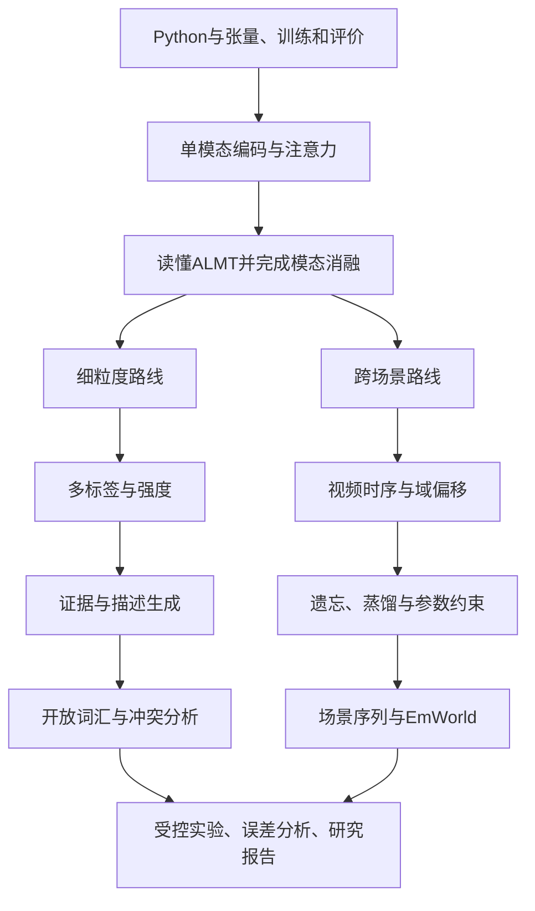

# 从 ALMT 复现走向细粒度与跨场景情绪研究：初学者完整学习路线

更新：2026-10-22。适用起点：科研基础较弱，已经接触 Python、PyTorch，并有 ALMT／CH-SIMS 的本地复现经历。本文是一份学习与实验计划，文中的新实验均为待完成任务。

**建议先用 8 周打通共同基础，再优先走“细粒度情绪识别与解释生成”，之后学习“跨场景持续学习”。** 两条路线都给出完整安排，但正式选题时先把一条做扎实。这里的“完整”指能够从基础走到一个可验证的研究问题，不是把所有相关论文都读完。

每周按 **10—12 小时主动学习**估算：基础 8 周＋细粒度 8 周＋跨场景 8 周＋研究整理 4 周，共约 28 周。如果只主攻一个方向，约 20 周。训练等待、数据申请和返工另计；遇到验收不过关时顺延。

**2026-10-28 修订：** 规划新增 P27—P36 十篇精读（阅读卡与完整精读陆续上线），补上无回放提示基线、增量学习协议定义、视觉-语言动态表情编码器、开放集识别与置信度校准。周数与阶段边界不变，已有进度继续有效。评估理由、显存可行性和新的选题建议见[第 12 节](#s12)。

## 导航

- [1. 两条方向究竟研究什么](#s1)
- [2. 你目前的位置与总体路线](#s2)
- [3. 共用基础：第 1—8 周](#s3)
- [4. 细粒度路线：第 9—16 周](#s4)
- [5. 跨场景路线：第 17—24 周](#s5)
- [6. 论文阅读卡：26 篇按用途拆解（P27—P36 陆续补充）](#s6)
- [7. 数据集、输入输出与评价指标](#s7)
- [8. 两个最小研究项目](#s8)
- [9. 第 25—28 周：形成研究报告](#s9)
- [10. 每周方法、记录模板与故障排查](#s10)
- [11. 从今天开始的七天清单](#s11)
- [12. 路线评估与 2026-10 修订](#s12)

<a id="s1"></a>
## 1. 两条方向究竟研究什么

### 1.1 共同母题：机器如何利用不同证据判断情绪

一段视频通常包含三类输入：**文本 T**（说了什么）、**音频 A**（怎么说的）、**视觉 V**（表情与动作）。模型先把它们转换成数字特征，再融合特征，最后输出预测。

例如，一个人说“我没事”，但说话哽咽、眉头紧皱。只读文字可能判断平静，结合音视频可能判断悲伤或压抑。这个例子只是帮助理解；真实标签要依据数据集标注，不能由直觉替代。

必须先分清五个概念：

| 概念 | 模型回答的问题 | 示例输出 | 不能混同的概念 |
|---|---|---|---|
| 情感倾向 sentiment | 总体偏积极还是消极？ | −0.6 | 负面不等于愤怒，也可能是悲伤 |
| 情绪类别 emotion | 表现出哪一种或哪些情绪？ | 悲伤、担忧 | 类别之间不一定互斥 |
| 情绪强度 intensity | 某种情绪有多强？ | 悲伤强度 2／3 | 预测概率 0.9 不等于强度 0.9 |
| 情绪描述 caption | 能否用文字描述表现？ | “声音低沉，面露担忧” | 文字流畅不代表内容有证据 |
| 解释 explanation | 为什么做出这个判断？ | 指出具体声音、画面或文本线索 | 注意力较高不等于因果解释 |

**细粒度**可以指更细的类别、多个情绪并存、强度、时间变化或局部证据。它不等于“类别数越多越好”。你当前的 ALMT 五分类主要是情感倾向的等级，不是五种具体情绪。

### 1.2 方向 A：细粒度情绪识别与有证据的描述生成

从“正面／负面”进一步回答：“悲伤还是担忧？是否同时存在？程度如何？可观察的依据是什么？”

学习次序是：**可靠融合 → 多标签分类 → 强度估计 → 证据记录 → 描述生成 → 开放词汇识别**。不要求第一天就同时解决这些问题。

推荐初期输出结构：

```text
输入：视频片段、音频、真实转写或 ASR 文本
输出 1：情绪类别及概率
输出 2：情绪强度（仅在有相应监督时训练）
输出 3：证据清单，如“音频 1.2—2.0 秒存在明显停顿”
输出 4：根据证据生成的简短描述
```

难点在于：标签主观、类别不平衡、模态之间可能矛盾，生成模型还可能补写输入中不存在的细节。

### 1.3 方向 B：跨场景、无回放持续学习

模型先在场景 A 学会识别表情，随后只拿到场景 B 的新数据，再拿到 C。希望学会新场景后，仍保留旧场景能力。

这里的“场景”应由真实元数据或明确的采集条件定义，例如不同拍摄环境、节目类型或镜头条件；不能把随机划分的三份数据叫作三个场景。

| 设置 | 训练时能看到什么 | 主要问题 |
|---|---|---|
| 多数据集分别训练 | 每个数据集分别有自己的训练集 | 方法在多套数据上是否有效 |
| 跨域泛化 | 仅源域训练，测试时去新域 | 没见过的环境能否适用 |
| 无监督域适应 | 有标签源域＋无标签目标域 | 如何利用目标域输入适应 |
| 域增量持续学习 | 场景按顺序到来，类别集合固定 | 适应新场景同时减少遗忘 |
| 类增量持续学习 | 新情绪类别不断出现 | 扩展类别同时保留旧类别 |

本路线 B 以**固定类别集合的场景／域增量**为主。CH-SIMS 和 MOSEI 分别重新训练，不能直接证明跨域泛化，更不能证明持续学习能力。

“无回放”在本路线中的约定：训练者跨阶段不保存并重新使用历史视频、音频、图像及逐样本特征；允许保存旧模型和必要统计状态，但必须报告大小。独立评测程序仍可保存历史测试集。学习完 B 后评价 A，不属于训练回放。

<a id="s2"></a>
## 2. 你目前的位置与总体路线

引用聊天《制定论文复现计划》已经完成 ALMT／CH-SIMS 三种子训练。本次又读取了本地汇总：二分类准确率约 **78.48% ± 0.77 个百分点**，五分类准确率约 **40.77% ± 1.54 个百分点**，MAE **0.4221 ± 0.0087**，以验证集 MAE 选模型。它是可继续分析的本地基线；引用聊天已说明尚未达到论文指标。

证据文件：[本地三种子汇总](D:/Dolphin/codex/sc/almt_local/multiseed_summary.json)。本次没有重新训练或复核全部历史运行日志。

**已经跑完训练不等于已经理解训练。** 你不必从头重复长实验，但需要补上“能解释输入形状、损失、选模和误差”的能力。



如果阅读器不支持 Mermaid，按以下文字顺序即可：共同基础 → ALMT 消融 → 选择 A 或 B → 最小实验 → 多种子验证 → 研究报告。图里的分支表示学习关系，不表示这些方法必须拼成一个模型。

### 阅读深度分三级

- **精读**：能画输入输出图，解释核心公式，读关键代码，做一个小实验。
- **方法读**：理解作者解决什么问题、方法如何工作、依赖什么假设，不要求复现全部结果。
- **选读**：只在实验遇到相应问题时展开，避免同时承担过多工程。

每条分支的最低精读量约 5—7 篇，其余是按需工具。第 6 节的 26 篇是整份路线的资料库，不是一个月的阅读任务。

<a id="s3"></a>
## 3. 共用基础：第 1—8 周

### 第 1 周：Python 与数据处理，先能看懂一条样本

**学什么：** 列表、字典、函数、类、文件路径、异常；NumPy 数组；CSV／JSON／PKL；训练集、验证集、测试集的职责。

**为什么：** 多模态项目很容易把同一片段的音频和文本对错。模型没有报错，不代表数据正确。

**动手：** 从现有数据读取少量样本，打印样本 ID、文本、音视频形状与标签；统计标签分布和缺失值。画出一条样本经过 `Dataset → DataLoader → model` 的路径。不要把不可信来源的 PKL 当作普通文本文件随意加载。

**验收：** 能指出每个维度的含义；能查出一个重复 ID；能说明测试集为什么不能用来选择超参数。若这些已经熟练，压缩到两天。

### 第 2 周：够用的数学，不先啃完整数学教材

| 知识 | 需要达到的程度 | 对应研究用途 |
|---|---|---|
| 向量与矩阵 | 理解点积、矩阵乘法、转置、范数、维度 | 特征相似度、线性层、注意力 |
| 导数与链式法则 | 能解释梯度为什么指向损失增长方向 | 反向传播、优化 |
| 概率 | 条件概率、期望、方差、独立性 | 标签不确定性、跨域分布 |
| 损失函数 | MAE、MSE、交叉熵、二元交叉熵 | 回归、单标签、多标签 |
| 统计 | 均值、样本标准差、抽样波动 | 三种子报告、误差分析 |

**动手：** 手算三个预测值的 MAE；用小矩阵演示乘法；用 PyTorch 自动微分核对一个标量函数的导数。训练一个线性回归模型，并观察学习率过大时损失如何变化。

**验收：** 能解释 `loss.backward()` 得到什么、`optimizer.step()` 改什么；知道“相关性高”不代表“数值误差小”。

### 第 3 周：PyTorch 完整训练循环

**学什么：** 张量与设备、`nn.Module`、前向与反向、优化器、`train/eval`、`no_grad`、保存与加载、固定种子、梯度累积。

**动手：** 用小型 MLP 做一次分类；保存权重，在新进程加载并核对同一输入的预测；故意只用 32 条训练样本，确认模型能够拟合这个小集合。

**验收：** 能独立写出训练和验证函数；知道忘记 `zero_grad`、忘记 `eval` 会造成什么；能指出梯度累积是多次反传后更新一次，不会减少总样本计算量。

资源：[PyTorch 官方基础教程](https://docs.pytorch.org/tutorials/beginner/basics/intro.html)。主要学数据、模型、自动微分、优化和保存加载；新版本教程中的接口与现有环境不一致时，先用当前环境兼容写法，不为学习练习改坏复现环境。

### 第 4 周：视觉、语音、文本如何变成特征

**学什么：** CNN／ResNet、token 与文本编码、音频波形与采样率、视频帧与时间轴；编码器与预测头的区别；冻结与微调。

**动手：** 画三路输入的示意图。先对缓存特征做均值池化与线性预测，再理解原始信号的编码。选读 P25 ResNet，开始 P02 BERT。

**验收：** 能说明“视频有 16 帧”与“视觉特征 16 个时间步”不一定是一回事；知道 padding 是补齐长度，mask 用来避免把补齐内容当真实信号。

### 第 5 周：注意力与 Transformer

**学什么：** Q/K/V、自注意力、交叉注意力、位置编码、残差、归一化。读 P01，再完成 P02。

核心公式：`Attention(Q,K,V) = softmax(QKᵀ / sqrt(d)) V`。

通俗解释：Q 表示“我在找什么”，K 表示“每条信息的索引”，V 表示“信息内容”。先算匹配程度，再按权重汇总内容。自注意力从同一序列取 Q/K/V；交叉注意力可以让文本去查找声音或画面信息。

**动手：** 用三条二维向量算出一个注意力矩阵；画出“3 个文本位置查询 5 个音频位置”的 3×5 权重图。

**验收：** 能推导 Q、K、V 和结果的形状；不会把交叉注意力直接说成准确的时间对齐或因果解释。

### 第 6 周：多模态融合、标注与评价

读 P07 CH-SIMS、P08 CMU-MOSEI，方法读 P05 MulT。

**学什么：** 早期拼接、后期融合、交叉注意力；模态缺失、噪声、不同步与情感冲突；数据集标签的实际含义。

**动手：** 比较仅文本、简单拼接两种预测头；画混淆矩阵；从训练／验证数据挑出 20 条失败样本，写出可能原因。分析失败时记录判断依据，不给模型错误随意编故事。

**验收：** 能解释“文本、语音、表情不同意”不一定是数据脏了；能区分 Macro-F1、Micro-F1、准确率和 MAE。

### 第 7—8 周：真正读懂现有 ALMT，补完模态消融

精读 P06，沿现有项目查找数据读取、三路编码、融合、输出与训练入口。每个关键张量写下 `[batch, time, feature]` 的具体含义。

第一轮重新训练以下三组，并与已有完整 ALMT 比较：T、T＋A、T＋V。消融必须真正移除不用的分支；测试时把模态置零是另一种实验。

**控制不变：** 数据划分、目标标签、验证选模规则、比较用的种子和训练预算；记录因模型结构引起的实际参数与耗时差异。先一个种子检查，再补其余预设种子。

**交付：** 一张含 MAE、Corr、Acc-2、Acc-5、参数量、耗时的表；一页输入输出图；至少 20 条误差分析。

**验收：** 能回答“音频／视觉是否提供稳定收益？”即使完整模型不占优，也能如实解释现有证据。消融不支持收益时，先检查数据、标签和模态特征，不急着加新模块。

基础教材使用[《动手学深度学习》](https://zh.d2l.ai/)的预备知识、线性网络、多层感知机、深度学习计算、CNN、序列与注意力相关部分。按当前问题查读，不要求整本学完才开始实验。

<a id="s4"></a>
## 4. 细粒度路线：第 9—16 周

这条路线直接承接 ALMT，但从 sentiment 回归切换到 emotion 多标签时，已经是新任务。所有“改 ALMT”的结果应写成任务适配，不冒充原论文复现。

| 周次 | 学习内容与论文 | 动手任务 | 阶段验收 |
|---|---|---|---|
| 9 | 多标签、类别不平衡、阈值；重读 P08 | 获取并按 ID 对齐 MOSEI 六种情绪标注；统计每类正例与共同出现频率 | 区分 sentiment、emotion、强度；输出标签对齐报告 |
| 10 | 多标签预测头与强度头；阈值与校准 P36 | 固定特征，比较 T、拼接与适配 ALMT；先做多标签，再加有监督强度头 | 使用验证集选阈值；报告逐类指标和失败样本；画可靠性图并报告 ECE |
| 11 | 对比表征与冻结编码器：P03、P04；视觉-语言动态表情 P29 | 只对一个小训练子集提取新特征；先替换视觉或音频之一；可加一组“冻结 CLIP 图像特征＋小型时序模块”对照 | 记录采样、维度与缓存；不同时换两路特征和融合器 |
| 12 | 抗噪与冲突：P09，开始 P14 | 区分自然冲突、人工噪声、音视频错配三种子集 | 能说明每个子集测什么；干净集也报告性能 |
| 13 | 解释任务：P10；生成与监督边界；开源大模型基线 P27 | 设计证据字段；做“标签模板”和“预测证据模板”；用 P27 做固定模型推理对照（8 GB 下用量化或缓存特征） | 所有生成输入均可在推理时获得；不把参考描述当输入；分清 P27 的训练描述是模型生成的伪标注 |
| 14 | 细粒度描述：P13；参数高效适配选读 P15 | 对小规模样本比较模板、标签驱动生成、证据驱动生成 | 能检查每条描述中的可观察事实及无依据细节 |
| 15 | 开放词汇：P11、P12；开放集：P28 | 学习官方标签归一化和评分；尝试固定模型的小样本评测；对同一批样本写出封闭集、开放集、开放词汇三种输出 | 知道同义词不等于新类别；锁定评价脚本和版本；区分拒识指标（AUROC、OSCR）与集合评分 |
| 16 | 收敛研究问题；团队前沿 P30 选读 | 选择一个失败模式，做一个针对性改动及消融 | 形成一页研究问题、方法图和对照实验表 |

### 4.1 多标签与强度怎么理解

六种情绪可以输出六个概率：`[快乐, 悲伤, 愤怒, 恐惧, 厌恶, 惊讶]`。多标签预测允许多个值超过阈值，例如悲伤与愤怒并存，通常采用独立 sigmoid 和二元交叉熵。单标签 softmax 强制候选类别竞争，适合互斥设定。

若有六维 0—3 强度标签，再训练六个连续数值。可以采用 `L = L_multi_label + λ L_intensity`，但 λ 必须在验证集确定。**这是本路线的教学实验设计，不是 ALMT 原方法。** 没有强度真值就暂不训练强度头。

MOSEI 六维情绪需另行核对完整标签，不能假定 sentiment PKL 已经提供。情绪存在性阈值与原始标注处理应按所选官方协议确定，报告时写清楚。

### 4.2 解释生成分三层做，避免一步跳到大模型

1. **预测标签 → 固定句式。** 例如“模型预测为悲伤”。它是输出展示基线，不是解释。
2. **预测标签＋可观察证据 → 结构化描述。** 如“该片段包含长停顿，语速较慢，模型据此倾向判断为悲伤”。停顿和语速需要检测依据；也不能把它们当作悲伤的充分条件。
3. **证据 → 语言模型整理。** 模型可以整理表述，但不能因此自动获得可靠性。加入“证据不足／模态不一致”的表达，并评估是否编造。

训练时可以用参考描述监督；测试生成时不能看该样本参考描述。人工核验可以用于评估输出，不能偷偷帮助测试阶段生成。把 CLIP 或 wav2vec 向量直接交给纯文本模型，并不会自动变成它能理解的证据，必须有明确的投影适配器或文字化观测接口。

### 4.3 建议优先形成的能力

- 读一条样本就能指出“输入、监督、预测、参考答案”分别是什么。
- 会在固定特征下比较融合器，不把编码器升级的收益全部归因于自己的融合模块。
- 会检查模型是否只靠文本做决定，以及辅助模态何时有益、何时有害。
- 会区分“解释符合人类直觉”“解释有输入证据”“解释忠实反映模型决策”这三种不同要求。

<a id="s5"></a>
## 5. 跨场景路线：第 17—24 周

如果你选择主攻跨场景，可以在共同基础完成后直接学习本节，不必先完成 A 的八周。这里优先用**视觉视频表情识别**建立场景增量协议，再考虑增加音频或文本；多模态、无回放、开放词汇和大模型不必一起上。

| 周次 | 学习内容与论文 | 动手任务 | 阶段验收 |
|---|---|---|---|
| 17 | 视频时间建模：P16；视觉-语言编码器 P29；补 P25 | 用冻结逐帧编码器＋均值池化训练视频分类头，再加小型时序模块；ResNet 与冻结 CLIP 特征各做一组 | 能解释单帧、短片段、整段视频的差别；编码器收益与时序模块收益分开报告 |
| 18 | 域偏移：P17；数据协议 P22；协议定义 P31；边界对照 P35 | 核对 FERV39k 场景映射、类别分布、源视频；确定三个场景或场景组 | 任务序列有真实依据，不能由随机切分命名；按 P31 写明属于 Domain-IL；说清与测试时适应（P35）的区别 |
| 19 | 灾难性遗忘；持续表情识别基准 P34 | 先做 A→B 两阶段顺序微调，每阶段测试全部已见场景 | 亲手得到第一张性能矩阵，观察旧场景下降；对照 P34 的设定与本路线有何不同 |
| 20 | 蒸馏：P18 LwF；可靠性 P36 | 冻结阶段 A 的旧模型，在 B 数据上约束新模型输出 | 旧模型无梯度；不读取 A 训练样本；比较新域学习与旧域保持；旧模型在新场景上的置信度先做校准分析 |
| 21 | 参数重要性：P19 EWC | 保存阶段末参数与 Fisher 对角近似，比较不同约束强度 | 能解释约束过强为何学不会新场景；统计保存状态大小 |
| 22 | 无回放提示基线：P32 L2P、P33 S-Prompts；P20 GPM 改为选读 | 在冻结 CLIP／ViT 特征上实现提示池或每场景提示，与 LwF、EWC 同表比较 | 报告提示参数量、场景／提示选择错误率；能区分原论文实现与自己的简化版本 |
| 23 | 直接相关研究：P21 EmWorld；交叉阅读 P30 | 画慢场景状态、快表情状态及观测关系；逐项核对其协议 | 能说明与 LwF／EWC／提示方法的思路差别；列出复现缺失条件 |
| 24 | 稳健比较与选题；P33、P34、P36 | 扩到三个场景、多个种子／顺序，形成对照表；对照表加入提示类基线 | 同时报新场景能力、旧场景遗忘与存储成本；差异用配对种子与置信区间表达 |

### 5.1 第一个持续学习实验应该很小

教学用例：场景 A→B→C，三个场景标签集合相同，训练时每阶段只读当前场景训练集，测试时使用一个共享分类头，不告诉模型真实场景 ID。

先固定编码器，只训练小的时间聚合器和分类头。对比：顺序微调、LwF 式蒸馏、EWC 式约束。联合使用所有场景数据训练可作为离线参考，但它不遵守无回放限制，也不是理论上的性能上界。

用合成噪声或亮度变化做 A→B 教学练习可以，但只能称合成域实验。得到结果后必须回到真实场景元数据，不能将教学用例写成正式跨场景结论。

### 5.2 用一个数字例子理解遗忘

以下是**虚构的教学数据**，行代表已学到第几个场景，列代表测试场景，单位为准确率百分比。

| 训练结束位置 | 测试 A | 测试 B | 测试 C |
|---|---:|---:|---:|
| 学完 A | 80 | — | — |
| 学完 B | 65 | 78 | — |
| 学完 C | 60 | 70 | 76 |

- 最终平均准确率：`AA = (60 + 70 + 76) / 3 = 68.67%`。
- 后向迁移：`BWT = [(60−80) + (70−78)] / 2 = −14` 个百分点。
- 本文的非负遗忘量：先取每个旧场景从首次学完到最终阶段的最高成绩，再减最终成绩，最后平均；本例 `F = 14` 个百分点。

正式记号：`R[t,j]` 是学完阶段 t 后在场景 j 的成绩；`AA = mean_j R[T,j]`，`BWT = mean_{j<T}(R[T,j]−R[j,j])`，`F = mean_{j<T}(max_{k=j,...,T}R[k,j]−R[T,j])`。不同论文可能采用不同 F 定义，比较时要统一。对 UAR 也能建立矩阵，但整张表必须使用同一指标。

一个模型若完全不更新，可能没有遗忘，却也学不会新场景。因此不能仅追求 F 小；同时报告 `R[t,t]`、最终 AA、逐场景 UAR 和跨阶段存储。

### 5.3 协议比复杂模块更重要

- 保留官方训练／测试边界；验证集从训练部分划分，并尽量按源视频或人物分组防止泄漏。
- 先检查每个场景是否有完整类别。缺类时固定有效类别规则并披露，不临时改变 UAR 分母。
- 不用未来场景和历史测试结果挑超参数；可以在独立开发序列上确定规则，再冻结配置做正式序列。
- 当前阶段结束后，训练者不得访问旧逐样本缓存。评测器和训练器的数据访问分离，逻辑隔离即可，不要求删除原始研究资料。
- 原论文若使用任务专属头或测试时任务 ID，不能把其成绩直接与共享头、无 ID 设置比较。
- 先固定一个顺序验证工程，再用多个预设顺序分析顺序敏感性；种子变化和顺序变化分别报告。

<a id="s6"></a>
## 6. 论文阅读卡：26 篇按用途拆解（P27—P36 陆续补充）

以下论文的题名与主要方法已查阅原论文、出版社页面或作者资料。每张卡的“练习”是为你设计的学习任务，不是论文原实验。完整公式与实验协议见原文。

**共同基础精读：P01、P02、P06；数据阅读：P07、P08。** A 重点读 P10—P14，P03—P05、P09、P15 按需深入；B 重点读 P16、P18、P19、P21、P22，P17 帮助区分问题，P20、P23、P24 是进阶。P25、P26 是视觉与对比学习补课材料。

**2026-10 规划新增 P27—P36（阅读卡与完整精读陆续上线）：** A 增加 P27 Emotion-LLaMA（开源多模态大模型基线）、P28 HESP（开放集视频表情识别）、P30 团队免训练情绪识别（选读）；B 增加 P31 三类增量学习（协议定义）、P32 L2P 与 P33 S-Prompts（无回放提示基线）、P34 ConFER 与 P35 CoTTA（选读对照）；两条线共用 P29 DFER-CLIP（视觉-语言动态表情编码器）和 P36 校准（阈值与可靠性）。

### P01｜Attention Is All You Need

Vaswani 等，NeurIPS 2017。[论文](https://arxiv.org/abs/1706.03762)。共同基础，精读注意力与编码器部分。

**问题：** 如何让序列里相距较远的位置直接交换信息，而不用一步步通过循环网络传递？

**方法：** 用多头注意力建立位置之间的联系，结合前馈网络、位置编码、残差和归一化。原任务是序列到序列翻译，后续许多模型借用其组件。

**白话理解：** 每个词都能去“询问”其他词哪些信息对自己有用，多头相当于从多个角度查询。位置编码补充顺序信息。

**练习与自测：** 实现一次注意力矩阵计算，解释为何 softmax 在键对应的维度上归一化。读后应能看懂 ALMT 的主要计算单元；不需要复现机器翻译。

### P02｜BERT: Pre-training of Deep Bidirectional Transformers for Language Understanding

Devlin 等，NAACL 2019。[论文](https://aclanthology.org/N19-1423/)。共同基础，精读。

**问题：** 如何先从大量无标注文字学会语言表征，再用少量任务标签学习分类或回归？

**方法：** 原始 BERT 使用掩码语言建模和下一句预测进行预训练；下游任务增加输出层并微调。双向上下文让一个词的表示受到左右内容影响。

**白话理解：** 同一个“好”放在“很好”和“好什么好”中不能用完全一样的表示。BERT 根据上下文生成向量，但不会自动正确识别所有讽刺。

**练习与自测：** 打印 token、mask 和编码输出；比较冻结 BERT 与微调 BERT 的可训练参数量。理解模型编码的是文本，情绪任务能力仍需监督或适当适配。

### P03｜Learning Transferable Visual Models From Natural Language Supervision（CLIP）

Radford 等，ICML 2021。[论文](https://proceedings.mlr.press/v139/radford21a.html)。A 方法读，B 可作为编码器参考。

**问题：** 视觉模型能否借助自然语言监督学习可迁移表征？

**方法：** 图像与文本分别编码；对比学习让匹配图文的向量接近，让不匹配的配对分开。推理时可比较图片与候选文字描述的相似度。

**白话理解：** 把图片和文字放到一个“语义坐标系”中，看看哪段文字更像这张图。

**练习与自测：** 对同一帧比较不同情绪提示语的相似度，并观察提示语变化带来的波动。它可作冻结视觉特征来源，但原始 CLIP 不是视频时间模型；相似度也不是经过校准的情绪强度。

### P04｜wav2vec 2.0: A Framework for Self-Supervised Learning of Speech Representations

Baevski 等，NeurIPS 2020。[论文](https://arxiv.org/abs/2006.11477)。A 方法读。

**问题：** 如何从大量未转写语音中学习有效的声音表示？

**方法：** 将波形编码为潜在特征，遮住部分时间位置，利用上下文区分正确的量化目标和干扰候选；随后可用于有监督语音任务。

**白话理解：** 遮住一小段声音，让模型利用前后声音识别应该匹配的内容，而非依赖每段语音都有人写转录。

**练习与自测：** 检查选用模型的采样率要求，提取一条音频的时间特征；比较均值池化与保留时间序列。语音预训练不等于情绪专用训练，换特征后仍需验证情绪收益。

### P05｜Multimodal Transformer for Unaligned Multimodal Language Sequences（MulT）

Tsai 等，ACL 2019。[论文](https://aclanthology.org/P19-1656/)。融合方法读。

**问题：** 文本、声音与视频采样速度不同，如何融合不等长序列？

**方法：** 使用有方向的两两跨模态注意力，让一种模态查询另一种模态不同时间位置的信息，学习跨模态长距离关系，不要求先做显式逐词强制对齐。

**白话理解：** 一句话不必只对应同一时刻的一帧；模型可以从整段声音和画面中查找相关内容。

**练习与自测：** 为三个文本位置和五个音频位置构造交叉注意力；与简单拼接画图比较。要分清“无需显式对齐”与“任何错配数据都能自动修好”。

### P06｜Learning Language-guided Adaptive Hyper-modality Representation for Multimodal Sentiment Analysis（ALMT）

Zhang 等，EMNLP 2023。[论文](https://aclanthology.org/2023.emnlp-main.49/) · [作者代码](https://github.com/Haoyu-ha/ALMT)。你的复现主线，精读。

**问题：** 音频和视觉包含与情感无关或与其他模态冲突的信息，直接融合可能降低预测质量。

**方法：** 用不同层次的语言特征引导 Adaptive Hyper-modality Learning，学习由音视频构成的辅助综合表征，再与语言融合进行情感预测。

**白话理解：** 先让文本帮助筛选声音和画面，再把筛选后的辅助信息与文本合起来。Hyper-modality 是学到的综合表征，不是新增一种传感器。

**练习与自测：** 画清文本引导出现在哪些位置，完成 T／T＋A／T＋V／T＋A＋V 消融。关键延伸问题：如果文本本身误导或冲突有语义价值，筛选是否可能丢掉有用信息？这是待实验验证的问题。

### P07｜CH-SIMS: A Chinese Multimodal Sentiment Analysis Dataset with Fine-grained Annotation of Modality

Yu 等，ACL 2020。[论文](https://aclanthology.org/2020.acl-main.343/)。数据章节必读。

**问题：** 一条综合标签无法充分反映文本、声音和画面各自表达的倾向。

**方法：** 除多模态整体标注外，提供独立单模态标注，并建立基于后期融合的多任务学习基线。

**白话理解：** 分别问“只听声音怎么判断”“只看画面怎么判断”，再问“综合起来怎么判断”。

**练习与自测：** 核对手头文件实际包含哪些标签；比较单模态与整体标注的差异。题名中的 fine-grained 主要涉及模态层面的细分标注，不能据此把数据理解为拥有大量具体情绪类别。

### P08｜Multimodal Language Analysis in the Wild: CMU-MOSEI Dataset and Interpretable Dynamic Fusion Graph

Zadeh 等，ACL 2018。[论文](https://aclanthology.org/P18-1208/)。A 数据章节精读，DFG 方法读。

**问题：** 如何在较大规模的自然多模态语言数据上研究情感与情绪，以及不同模态的交互？

**方法：** 建立 CMU-MOSEI；提出 Dynamic Fusion Graph，以动态交互权重组织单模态及跨模态信息。

**白话理解：** 不只问“文字、声音、画面分别有多重要”，也考虑它们的组合怎样影响预测。

**练习与自测：** 给同一片段列出 sentiment 与六种 emotion 强度，解释两套标签的不同。下一步以 ID 对齐特征和标签。图中的权重便于分析，但不能自动当作因果结论。

### P09｜Noise-Resistant Multimodal Transformer for Emotion Recognition（NORM-TR）

Liu 等，IJCV 2025；可访问预印本始于 2023 年。[预印本](https://arxiv.org/abs/2305.02814) · [期刊 DOI](https://doi.org/10.1007/s11263-024-02304-3)。A 抗噪方法读；实施时以期刊全文核对细节。

**问题：** 某些模态局部受到干扰时，如何保持稳定预测？

**方法：** 学习抗扰动的通用表征，再用 Transformer 从多模态特征中补充细节；训练时构造模态扰动，并通过相应对抗目标鼓励表征对噪声不敏感。

**白话理解：** 先找不容易被噪声改变的“共同信息”，再补充可能有用的细节。

**练习与自测：** 固定测试扰动强度与随机种子，绘制性能随噪声增加的变化。不要把“说没事但哽咽”直接视作应消除的噪声，它可能包含情绪线索。

### P10｜Explainable Multimodal Emotion Recognition（EMER）

Lian 等，arXiv:2306.15401，本文参考 2024 年修订版。[论文](https://arxiv.org/abs/2306.15401)。A 精读任务定义和评价。

**问题：** 固定类别和多数投票可能忽略细微但合理的情绪，如何把判断依据纳入标注与预测？

**方法：** 构建带解释的多模态情绪任务，结合单模态线索与语言模型消歧生成更完整的解释，并由此支持开放词汇情绪表达；提供数据、基线和评价。

**白话理解：** 从“答案是悲伤”进一步走到“依据哪些表现判断悲伤”。

**练习与自测：** 将十条描述拆为“观察事实”和“情绪推断”，标出没有依据的内容。本卡 EMER 是 Explainable Multimodal Emotion Recognition，不是团队另一项眼动与人脸数据集的同名缩写。

### P11｜OV-MER: Towards Open-Vocabulary Multimodal Emotion Recognition

Lian 等，ICML 2025。[论文](https://proceedings.mlr.press/v267/lian25b.html)。A 精读任务与指标。

**问题：** 模型能否输出固定标签集合之外、更细致或多种并存的情绪？

**方法：** 提出开放词汇多模态情绪识别任务、数据及相应评价，处理自由情绪表达与参考标签之间的语义关系。

**白话理解：** 从固定选项题变成可以写“失落又有些释然”的开放回答；评分也不能只检查字符串完全相同。

**练习与自测：** 比较“开心／高兴”等同义表达与“满意／自豪”等不同表达，阅读官方归一化和评分流程。只增加分类头输出数仍是闭集分类；仅拒绝未知类别是开放集识别，也不等同于开放词汇识别。

### P12｜AffectGPT: A New Dataset, Model, and Benchmark for Emotion Understanding with Multimodal Large Language Models

Lian 等，ICML 2025。[论文](https://proceedings.mlr.press/v267/lian25a.html) · [项目](https://github.com/zeroQiaoba/AffectGPT)。A 方法精读，完整训练选做。

**问题：** 情绪大模型需要丰富描述监督，也需要更有效地整合多模态输入。

**方法：** 构建 MER-Caption 描述数据；通过进入语言模型前的预融合增强多模态整合；使用 MER-UniBench 评估多种情绪理解任务和自由文本输出。

**白话理解：** 让模型学到“输入证据和情绪描述如何对应”，并先整理音视频信息再交给语言生成模块。

**练习与自测：** 绘制编码器、预融合、语言模型和监督数据之间的关系；核查模型生成标注与人工标注的区别。本文指 2025 版本，不与 2024 年同名相关预印本混写；本机先做小样本推理或特征级实验。

### P13｜Emotion-oriented Cross-modal Prompting and Alignment for Human-centric Emotional Video Captioning（ECPA）

Wang 等，IEEE TMM 2025。[期刊 DOI](https://doi.org/10.1109/TMM.2025.3535292) · [作者稿](https://cvlab-liuyuanyuan.github.io/pdf/journalpaper/Emotion-oriented%20Cross-modal%20Prompting%20and%20Alignment%20for%20Human-centric%20Emotional%20Video%20Captioning.pdf) · [代码](https://github.com/virtuesvvy/ECPA_Emotional_Video_Captioning)。A 精读。

**问题：** 普通视频描述偏重“发生了什么”，容易漏掉细微情绪表现。

**方法：** 视觉端结合情绪识别级和面部动作单元 AU 级提示；文本端结合句子级和词级提示；通过情绪—句子、AU—词两个层次的跨模态对齐帮助生成情绪描述。

**白话理解：** 同时关注整体情绪和眉眼嘴等局部动作，并让这些视觉线索与描述语言建立对应。

**练习与自测：** 给一段描述标出整体情绪词与局部动作词。可学习它的分层对齐思路，但 AU 不与某种真实内心情绪一一对应。作者仓库写明 Linux＋NVIDIA 条件，Windows 笔记本不宜把完整复现设为第一关。

### P14｜CERA: Conflict-Explicit Reflective Agent for Multimodal Emotion Reasoning

Liu 等，ICMR 2026。[作者稿](https://cvlab-liuyuanyuan.github.io/pdf/conferencepaper/2026_ICMR_CERA.pdf) · [DOI](https://doi.org/10.1145/3805622.3810634)。A 进阶精读。

**问题：** 不同模态的情绪线索相互矛盾时，一味忽略冲突可能丢失关键信息。

**方法：** 采用感知—评价—反思循环：用细粒度线索构建情绪图，评价模型产生自然语言反馈，再根据反馈编辑和细化图；论文框架不需要为该循环更新模型参数。

**白话理解：** 先把各路证据列出来，指出彼此矛盾之处，再检查和修正判断，而非直接让某一模态压过其他模态。

**练习与自测：** 手工画一个冲突图，比较一次判断与多轮修正。无训练并不等于无推理成本，也不保证反思必然正确。音频扩展若超出原文设置，应明确标为自己的设计。

### P15｜LoRA: Low-Rank Adaptation of Large Language Models

Hu 等，ICLR 2022，预印本 2021。[论文](https://arxiv.org/abs/2106.09685)。两条路线的工具性选读。

**问题：** 微调整个大模型需要保存和更新很多参数，如何降低适配成本？

**方法：** 冻结原权重 W，用两个小矩阵的乘积表示增量 `ΔW = BA`，只训练这些新增参数。

**白话理解：** 不重写整本教材，只学习一份结构受限的修改说明。

**练习与自测：** 对一个 768×768 线性层计算不同秩 r 下新增参数量 `r×768 + 768×r`。LoRA 减少训练参数，但底座与激活仍占显存；它本身不自动解决遗忘，也不保证任意大模型能在 8 GB 显存训练。

### P16｜Expression Snippet Transformer for Robust Video-based Facial Expression Recognition（EST）

Liu 等，Pattern Recognition 2023。[作者稿](https://cvlab-liuyuanyuan.github.io/pdf/journalpaper/Expression%20Snippet%20Transformer%20for%20Robust%20Video-based%20Facial%20Expression%20Recognition.pdf) · [代码](https://github.com/DreamMr/EST)。B 精读。

**问题：** 表情变化很微小，直接在整段视频上建模可能忽略短时间内的重要变化。

**方法：** 把视频分成短片段；在片段内部用注意力增强的特征提取器捕捉细微动作，在片段之间借助打乱顺序预测任务强化时间关系学习。

**白话理解：** 既看每几帧之间“脸怎么动”，又看这些小动作先后怎样发生。

**练习与自测：** 画出采帧、分片段、片内编码、片间建模与分类的流程。先完成一个训练子集的诊断；一个折或作者权重测试不等于完成论文全部交叉验证。

### P17｜Domain-Adversarial Training of Neural Networks（DANN）

Ganin 等，JMLR 2016。[论文](https://jmlr.org/papers/v17/15-239.html)。B 概念方法读。

**问题：** 源域和目标域输入分布不同，模型容易记住域特征而不是任务特征。

**方法：** 用任务分类器保留类别信息，同时用域分类器和梯度反转让编码器学习难以区分域的表征。经典设置使用有标签源域与无标签目标域。

**白话理解：** 希望模型看得出表情，却不容易仅凭特征分辨样本来自哪个环境。

**练习与自测：** 画出任务损失与域损失作用方向。DANN 是理解域适应的教材，不直接满足“只能访问当前场景、无历史数据”的持续学习协议；盲目对齐还可能破坏类别结构。

### P18｜Learning without Forgetting（LwF）

Li、Hoiem，ECCV 2016；链接包含期刊扩展版本。[论文](https://arxiv.org/abs/1606.09282)。B 精读并实现简化适配。

**问题：** 没有旧任务训练数据，如何尽量保留已有能力？

**方法：** 保留旧网络在新数据上的输出，用蒸馏约束新网络，同时学习新任务。原论文设置与本路线共享标签头的域增量设置并不完全相同。

**白话理解：** 旧模型当老师，让新模型学习新知识时，别随意改变老师已有的判断方式。

**练习与自测：** 实现 `L = L_current + λ T² KL(p_old^T || p_new^T)` 的教学版本，检查老师参数不更新。若老师在新域上输出不可靠，蒸馏可能限制新知识，因此称“LwF 式共享头适配”，不能冒充原实验。

### P19｜Overcoming catastrophic forgetting in neural networks（EWC）

Kirkpatrick 等，PNAS 2017。[论文](https://arxiv.org/abs/1612.00796) · [DOI](https://doi.org/10.1073/pnas.1611835114)。B 精读。

**问题：** 学习新任务修改参数时，怎样减少对旧知识的破坏？

**方法：** 用 Fisher 信息的对角近似估计参数重要性，对重要参数偏离旧值施加更强惩罚：`L = L_current + λ/2 × Σ_i F_i(θ_i−θ_i*)²`。

**白话理解：** 给重要零件加更硬的弹簧，不让它们被新任务随意拉走；不重要的零件可以多调整。

**练习与自测：** 在两阶段小模型上比较 λ=0、小 λ、大 λ，观察新旧任务成绩。Fisher 估计方式与多阶段状态累计规则必须记录；在线压缩版本不能不加说明地叫原始 EWC。

### P20｜Gradient Projection Memory for Continual Learning（GPM）

Saha 等，ICLR 2021。[论文](https://arxiv.org/abs/2103.09762) · [作者代码](https://github.com/sahagobinda/GPM)。B 进阶选读。

**问题：** 能否限制参数更新方向，避免破坏对旧任务重要的表示方向？

**方法：** 根据层激活矩阵的奇异值分解提取并保存重要子空间基，学习新任务时把梯度中对应的分量投影掉。

**白话理解：** 已有知识占用了部分“方向”，新学习尽量沿其他方向进行。

**练习与自测：** 用二维向量演示 `g_new = g − UUᵀg`，其中 U 列向量正交。再看网络层中矩阵方向如何匹配；不要把这个向量教学式未经推导地套到所有权重。子空间会占存储且可能扩张，需要统计。

### P21｜EmWorld: Emotion World Model with Latent State Evolution for Scenario-Incremental Dynamic Facial Expression Recognition

Wang 等，ICML 2026，按作者公开稿阅读。[作者稿](https://cvlab-liuyuanyuan.github.io/pdf/conferencepaper/2026_ICML_EmWorld.pdf)。B 直接相关的进阶精读。

**问题：** 场景条件不断改变，表情的时间轨迹也在变化，怎样同时建模二者？

**方法：** 以潜在状态的渐进贝叶斯推断组织学习，使用双时间尺度：慢尺度描述场景演化，快尺度描述帧级表情动态，再联合推断以减少场景因素对表情表示的干扰。

**白话理解：** 场景像缓慢变化的背景条件，表情像较快变化的动作。模型尝试分别理解二者怎样改变，而不是把所有变化混在一起。

**练习与自测：** 标出观测、潜在状态、先验与更新；核对训练能访问哪些数据。它研究潜在状态演化，不应仅因“世界模型”一词就理解为生成逼真视频。完整实现需要额外补概率推断；先学会 LwF／EWC 再读公式。

### P22｜FERV39k: A Large-Scale Multi-Scene Dataset for Facial Expression Recognition in Videos

Wang 等，CVPR 2022。[论文](https://openaccess.thecvf.com/content/CVPR2022/papers/Wang_FERV39k_A_Large-Scale_Multi-Scene_Dataset_for_Facial_Expression_Recognition_in_CVPR_2022_paper.pdf) · [项目](https://github.com/wangyanckxx/FERV39k)。B 数据章节精读。

**问题：** 如何在多场景自然视频中系统评价动态表情识别？

**方法：** 构造多场景层次数据与标注流程，并比较视频表情基线，分析采帧、时间动态及场景信息的影响。

**白话理解：** 同样的“惊讶”可能出现在采访或影视片段中，环境会改变模型看到的线索。

**练习与自测：** 根据发布元数据生成“场景×类别”计数表，检查每组样本量与标签覆盖。数据集有场景信息不意味着你已获得可直接复用的持续学习协议；具体映射和划分还要核对下载材料。

### P23｜Pose-disentangled Contrastive Learning for Self-supervised Facial Representation（PCL）

Liu 等，CVPR 2023。[论文](https://cvlab-liuyuanyuan.github.io/pdf/conferencepaper/Liu_Pose-Disentangled_Contrastive_Learning_for_Self-Supervised_Facial_Representation_CVPR_2023_paper.pdf) · [代码](https://github.com/DreamMr/PCL)。B 表征进阶选读。

**问题：** 对比学习若把姿态变化全部当作应忽略因素，可能丢掉对人脸任务有用的信息。

**方法：** 用姿态解耦解码器与正交约束，将姿态相关和其他人脸信息分开学习，并增加姿态相关对比学习。

**白话理解：** 不直接删掉“头怎么转”，而是把它与“脸本身表达什么”分开表示。

**练习与自测：** 从 P26 的正负样本概念出发，解释不同增强会影响哪类信息。该方法是人脸表示预训练，不是持续学习算法；适合在发现姿态造成明显误差后补读。

### P24｜Sample-Cohesive Pose-Aware Contrastive Facial Representation Learning（PCFRL）

Liu 等，IJCV 2025。[论文](https://cvlab-liuyuanyuan.github.io/pdf/journalpaper/Sample-Cohesive%20Pose-Aware%20Contrastive%20Facial%20Representation%20Learning.pdf) · [DOI](https://doi.org/10.1007/s11263-025-02348-z)。B 选读，接 P23。

**问题：** 不同图片在某种语义上可能相似，把它们都当负样本推远，会伤害表征。

**方法：** 在姿态与人脸信息解耦基础上，通过邻域凝聚的样本关系进行伪负样本校准，再分别使用校准后的姿态与人脸对比目标。

**白话理解：** 先检查“这两个样本真的应该被推开吗”；姿态相似不代表表情相同，两种关系不能混用。

**练习与自测：** 画一个包含身份、姿态、表情三个因素的样本关系表。EST→PCL→PCFRL 是可选学习顺序，不是必须串接的模型流水线。

### P25｜Deep Residual Learning for Image Recognition（ResNet）

He 等，CVPR 2016，预印本 2015。[论文](https://arxiv.org/abs/1512.03385)。视觉基础补读。

**问题：** 网络加深后为何更难优化，如何让深层模型更容易学习？

**方法：** 使用残差连接，令模块输出 `y = F(x) + x`，维度变化时用相应投影匹配。

**白话理解：** 模块可以先保留已有表示，再学习需要修改的部分，不必每层都重新构造全部信息。

**练习与自测：** 画一个残差块，检查相加两端形状；用现成 ResNet 提取逐帧特征。它提供空间编码基础，视频时间关系还要另外建模。

### P26｜A Simple Framework for Contrastive Learning of Visual Representations（SimCLR）

Chen 等，ICML 2020。[论文](https://proceedings.mlr.press/v119/chen20j.html)。PCL／PCFRL 前的补课。

**问题：** 缺少类别标注时，怎样用图像本身学习表征？

**方法：** 对同一图片做两种增强，编码后经过投影头，把同源视图作为正对，其余视图作为负对，通过对比目标学习表示。

**白话理解：** 同一张图的不同观察方式应该仍能认出彼此；但增强不能随便破坏任务需要的信息。

**练习与自测：** 对四张图片各做两种增强，列出每个视图的正负样本。理解裁剪若去掉嘴角或眉眼，可能改变情绪线索。小批量教学练习用于学机制，不能当作原规模自监督结果。

<a id="s7"></a>
## 7. 数据集、输入输出与评价指标

### 7.1 按学习目的选数据，不一次下载所有数据

| 数据集 | 在本路线的角色 | 要拿到什么 | 特别注意 |
|---|---|---|---|
| CH-SIMS | 共同基础与 ALMT 消融 | 当前特征、ID、划分、标签；需要人工观察时再找原片段 | 各模态标签与综合标签不同；不是六类情绪数据 |
| CMU-MOSEI | A 的多标签与强度起点；也可验证原 sentiment 方法 | 原协议特征、标准划分、完整情绪标注；重提特征时需要原始音视频 | sentiment 与 emotion 监督分开；标签必须按 ID 对齐 |
| MAFW | A 的复合表情、描述；B 的补充数据 | 视频、类别／复合标注、描述、官方划分及可用元数据 | 描述的输入／目标角色依任务而定；分布标签不是强度 |
| OV-MERD／OV-MERD+ | A 的开放词汇评价 | 对应版本的样本、标注、评价脚本 | 不把原版、扩展版和第三方处理版混为一套协议 |
| MER-Caption／MER-Caption+ | A 的描述监督 | 先看标注和对应 ID，再按需准备媒体 | 核实筛选版本与标注来源；避免与评测样本重叠 |
| FERV39k | B 的真实场景序列 | 视频、表情标签、场景映射、官方划分 | 申请后仍需核对场景字段实际可用性 |

官方入口：[MMSA](https://github.com/thuiar/MMSA)、[CMU SDK](https://github.com/CMU-MultiComp-Lab/CMU-MultimodalSDK)、[MAFW](https://mafw-database.github.io/MAFW/)、[AffectGPT 数据与评测项目](https://github.com/zeroQiaoba/AffectGPT)、[MER2025 数据发布](https://huggingface.co/datasets/MERChallenge/MER2025)、[FERV39k](https://github.com/wangyanckxx/FERV39k)。入口用于查阅发布协议，不代表本次已下载数据或验证所有下载文件。

MAFW 官网提供单一／复合表情、双语描述及表情分布信息。若目标是从视频生成描述，就把描述作为监督／参考；若复现某个以描述作为输入的官方多模态分类协议，则必须按该协议解释任务，不能把它与仅用真实转写的部署设定混报。[MAFW 标注说明](https://mafw-database.github.io/MAFW/)

### 7.2 指标要与问题对应

| 问题 | 建议主指标 | 初学者理解 | 常见误区 |
|---|---|---|---|
| sentiment／强度回归 | MAE、Corr；强度逐类报告 | MAE 看偏差大小；Corr 看变化趋势是否一致 | 相关性高不代表预测刻度准确 |
| 单标签情绪分类 | UAR、WAR／Accuracy、Macro-F1 | UAR 先算每类召回再平均，减少大类支配 | 只看总体准确率忽略少数类 |
| 多标签情绪 | Macro-F1、Micro-F1、mAP（按协议） | 每类看得好不好；整体正例找得好不好 | 测试集上反复调阈值 |
| 开放词汇 | 选定官方语义归一化和集合评分 | 需要处理同义、层级和多个标签 | 用字面字符串匹配代替完整官方协议 |
| 开放集识别 | 闭集准确率＋AUROC＋OSCR（按协议） | 既要分对已知类，又要把未知类拒识出来 | 把拒识当成开放词汇，或只报闭集准确率 |
| 置信度可靠性 | ECE、可靠性图、NLL | 预测说 80% 有把握时，实际是否约 80% 正确 | 把最大概率直接当可靠性；在测试集上拟合温度 |
| 描述生成 | 参考文本指标＋独立事实／证据评价 | 一部分看参考相似，一部分看有无编造 | 用 BLEU／CIDEr 高分证明解释真实 |
| 跨场景持续学习 | AA、BWT、F、逐场景 UAR | 新场景学得如何，旧场景忘掉多少 | 只报告最后一个场景，或只报告遗忘 |

精确率 P 表示“预测为正的样本中有多少确实为正”；召回率 R 表示“真实正例中找回多少”；`F1=2PR/(P+R)`。Macro 是先逐类算再平均，Micro 是汇总各类计数再算。类别极不平衡时二者差异可能很大。

若报告 UAR，写清参与计算的类别和零支持类别处理方式。若报告强度相关系数，某类真值几乎不变化时应检查相关系数是否可定义。缺失值不能随意用 0 替代后当作真实中性标签。

### 7.3 有依据的描述怎样评价

先固定一个按类别／冲突情况分层的评测子集，例如 100 条，这是拟定规模，可随资源调整。两位评价者独立盲评，不展示方法名，记录分歧与一致程度。

将每条生成描述拆成可判断的陈述，例如“出现笑容”“说话停顿”“表现出担忧”。分别标为：输入支持、输入反驳、证据不足。统计：

- 可核验陈述中被输入支持的比例。
- 无依据或与输入矛盾的陈述比例，说明分母。
- 情绪判断与参考标注的一致性，同时保留合理多解和标注歧义。
- 是否遗漏关键冲突，是否在证据不足时过度肯定。

这些是本路线建议的人工评价定义，不冒称某篇论文的官方指标。若用模型当评委，记录其版本、提示与偏差，并保留人工抽查。遮蔽重要证据再观察预测变化，可作为忠实性诊断；同时做随机遮蔽对照，并注意遮蔽可能导致输入分布异常。

<a id="s8"></a>
## 8. 两个最小研究项目

### 项目 A：从情绪多标签预测到证据约束描述

**待回答的问题：** 在同样的输入和计算预算下，使用可核验的预测证据，是否能减少描述中无依据的细节，同时保持情绪识别表现？

这是研究问题，不是预先成立的结论，也不预先保证创新。先调查 P10—P14 的具体做法，再确定与你的数据、模型和评价设置的差异。

**最小结构：** 固定编码器 → 轻量融合 → 多标签头；另设可观察证据提取接口 → 模板或固定语言模型生成。强度头作为第二阶段扩展。先在有标签的数据上验证识别，再在有描述参考的数据上验证生成；不能把不同数据上的两个分数拼成“同一测试集的端到端结果”。

| 对照 | 改变什么 | 要回答什么 |
|---|---|---|
| T 单模态、简单拼接、适配 ALMT | 融合方式 | 多模态和复杂融合是否必要 |
| 标签模板 | 不自由生成 | 最简单输出有多大作用 |
| 预测标签驱动生成 | 只给预测情绪 | 文本扩写会产生多少无依据细节 |
| 预测标签＋预测证据生成 | 增加可核验输入线索 | 证据是否改善支持率 |
| 移除一种证据来源 | 对证据模块做消融 | 改善来自声音、视觉还是转写 |
| 普通／冲突／扰动子集 | 固定定义的测试分组 | 改善发生在哪些样本上 |

**第一轮范围：** 一个预设种子、一个数据集的小规模工程验证；正式结果扩到完整划分与至少三个预设种子。生成模型、提示、解码参数和样本选择规则固定。不同随机种子不能只保留最好的。

**允许失败的结论：** 若证据方法没有改善，检查证据提取是否本身不可靠；若识别提升而描述更爱编造，应分开报告。不要为了得出正面结果不断更换测试子集。

**交付清单：** 数据对齐报告、预测文件、特征版本、配置、对照指标、分层误差分析、人工评价规则和模型输入示例。只有这些齐全后，才考虑更复杂的门控、冲突图或适配器。

### 项目 B：跨场景蒸馏何时有效、何时妨碍新学习

**待回答的问题：** 旧模型在新场景上的判断越不可靠，直接保持其输出是否越容易损害新场景学习？能否在明确的无回放约束下改善这种权衡？

**最小结构：** 冻结视觉编码器＋共享小型时序模块／分类头，固定类别与单头评价。先不引入复杂的多模态大模型。

| 对照 | 保存什么 | 实验地位 |
|---|---|---|
| 顺序微调 | 当前模型 | 遗忘基线 |
| 完全冻结模型 | 初始模型 | 仅作不学习诊断，不当主要成果 |
| LwF 式共享头蒸馏 | 上一阶段模型 | 保持输出的基线 |
| EWC 式约束 | 参数快照与重要性 | 保持重要参数的基线 |
| 提示式无回放基线（P32 L2P／P33 S-Prompts 式） | 冻结预训练主干＋提示池或每场景提示＋键 | 强无回放基线；报告提示参数量与场景／提示选择错误 |
| 可靠性调节蒸馏，若值得继续 | 相同旧模型＋小量统计 | 待验证改进；不预先宣称创新 |
| 联合训练 | 所有场景训练数据 | 单独列出的离线参考 |

“可靠性”不能简单等同于最大预测概率：错误的旧模型也可能很自信。先做校准分析（ECE、可靠性图，见 P36）或增强一致性分析；任何学习到的门控都只能使用当前允许访问的数据。若直接使用当前监督标签构造可靠性信号，也必须明确这是有监督场景增量设置。

**第一轮范围：** 两个场景、一种顺序、一个种子，验证训练和评测隔离；之后三个场景、三个预设种子，再增加预设顺序。资源不足时先固定一条正式顺序做稳定性，清楚标出尚未评估顺序敏感性。

**交付清单：** 任务划分文件、每阶段允许访问的数据清单、完整性能矩阵、AA／BWT／F、逐类指标、每阶段耗时、模型与额外状态存储。没有这些，不能仅凭最终准确率声称“解决遗忘”。

### 8.1 如何选主线

| 你的实际情况 | 优先建议 |
|---|---|
| 已熟悉 ALMT，希望尽快承接现有实验 | 先 A 的多标签与强度，暂缓大型生成模型 |
| 更喜欢视频分析、数学约束和清晰实验协议 | 先 B 的顺序微调／LwF／EWC |
| 已拿到高质量描述标注与可用推理资源 | A 可更快进入证据与描述 |
| 场景元数据不完整或没有可用场景映射 | B 先做教学练习，正式场景实验等资料齐备 |
| 两条都感兴趣但时间不足 | 约 80% 精力做主线，20% 阅读另一条，不同时维护两套大实验 |

### 8.2 本机实施原则

沿用此前约 8 GB 显存的 RTX 4070 Laptop 条件做资源规划，**本轮未重新检测硬件**。实验前以实测可用显存为准。

- 现有 ALMT 环境优先保持稳定。新特征提取或大模型实验放独立环境，记录解释器路径与依赖。
- 初期分开加载视觉、语音编码器，提取并缓存特征，训练阶段只放小模型。缓存时记录模型版本、预处理、采样规则和样本 ID。
- 当前环境路径为 `D:\Dolphin\codex\sc\almt_local\env\python.exe`；这是已有复现环境路径，不代表新论文都兼容其依赖。
- B 的旧阶段特征可以保存在受控存档中，但训练器切换阶段后不得继续读取；否则就不符合本路线的无回放定义。
- 训练前短跑估计峰值显存与每轮时间；不把此前 ALMT 耗时套用到视频解码或大模型任务。
- 原始媒体可放外置 SSD；使用缓存特征时重点看内存和加载方式。日志、检查点尽量留本机，避免训练中断开外置盘。

<a id="s9"></a>
## 9. 第 25—28 周：形成研究报告

| 周次 | 目标 | 交付 |
|---|---|---|
| 25 | 锁定一个问题和最小变化 | 一页问题定义：任务、动机、已有缺口、验证办法 |
| 26 | 固定配置补正式实验 | 多种子结果、必要消融、计算成本，保留失败运行说明 |
| 27 | 误差分析与相关工作定位 | 按失败类型分组；对照关键论文，明确相同点与不同点 |
| 28 | 完成可复查研究报告 | 方法图、数据协议、结果表、限制、配置和运行说明 |

一份合格的初步报告应能回答六件事：

1. **问题在哪里？** 用失败样本或分组统计说明，不只说“现有方法效果不好”。
2. **你改了什么？** 一个能清楚描述的变化，区分数据、编码器、融合和训练策略。
3. **为何可能有效？** 给出机制假设，而不是只罗列模块。
4. **如何证明？** 公平基线、消融、多个种子、逐类或逐场景分析。
5. **代价是什么？** 参数、显存、耗时、额外存储或推理调用次数。
6. **哪里仍然失败？** 保留负面结果、适用条件和无法验证的部分。

第一次完成这样的闭环，即使方法没有超过论文，也已经比“跑出一个高分但说不清原因”更接近独立科研。

<a id="s10"></a>
## 10. 每周方法、记录模板与故障排查

### 10.1 每周学习节奏

建议每周安排：3 小时读论文、4 小时写代码／做实验、2 小时看结果、1—3 小时补知识和记录。一次读不懂整篇很正常，但应带着具体问题返回教材。

读论文分三遍：第一遍约 30—45 分钟看摘要、图和结论，写清问题；第二遍约 1—2 小时追踪输入输出与损失；第三遍结合代码和消融核对假设。精读可能跨越数天，不以翻完页数作为完成标准。

英语基础较弱时，先记任务关键词和变量定义，再读图注与方法。可以用辅助翻译，但关键术语、公式、数据划分和否定句必须回到原文核对。

### 10.2 论文笔记模板

```markdown
# 论文题名／年份／链接／阅读版本
我现在需要它解决的问题：
输入：
训练监督：
推理阶段实际可用的信息：
输出：
最接近的简单基线：
核心变化，用自己的话写三句话：
一个关键公式，各符号含义：
数据集与划分：
模型如何选、阈值如何选：
作者用哪项消融支持该变化：
方法的一个限制：
我能在本机完成的最小练习：
尚未读懂的一个具体问题：
```

读后闭卷讲五分钟：问题是什么、为什么简单方法不够、信息怎样流动、训练信号是什么、实验如何证明有效。讲不清的地方就是下一次需要补的知识。

### 10.3 实验记录模板

```markdown
# 实验 ID 与日期
研究问题：
代码版本／解释器／依赖清单：
数据版本、哈希、样本 ID 与划分文件：
唯一主要变化：
输入模态与特征版本：
训练预算、种子、有效 batch、优化器：
验证选模规则／多标签阈值规则：
主指标与辅助指标：
逐样本预测文件：
训练耗时／峰值显存／额外状态大小：
结果：
与基线差异及随机波动：
失败样本与可能原因：
结论能支持什么、不能支持什么：
下一步：
```

### 10.4 初学者常见卡点

| 现象 | 先检查什么 | 不宜马上做什么 |
|---|---|---|
| 训练损失下降，验证集不改善 | 泄漏、划分、过拟合、标签与学习率 | 不停延长训练或更换种子 |
| 多模态不如文本 | 音视频 ID、mask、特征尺度、质量、优化差异 | 直接断言多模态无用，或加更多融合层 |
| 多标签模型几乎全预测负类 | 正例比例、损失权重、阈值、标签处理 | 只用准确率声称效果很好 |
| 生成文字好看却不准确 | 输入证据是否真实，生成是否看到了参考答案 | 只靠更长提示解决所有问题 |
| 遗忘为零 | 模型是否更新、旧指标是否被覆盖、新场景是否学会 | 直接宣布持续学习成功 |
| EWC／蒸馏不如顺序微调 | 约束尺度、老师质量、温度、梯度、预算 | 只挑一个最有利场景汇报 |
| 实验偶尔提升一点 | 多种子均值、样本误差、种子配对、重复比较 | 把随机波动写成稳定创新 |
| 论文代码无法直接运行 | 依赖、路径、数据版、权重、完整训练入口 | 只凭仓库存在就承诺能复现 |

### 10.5 学习完成判据

- [ ] 我能独立解释数据、模型、损失、评价四者的关系。
- [ ] 我能从空白文件写一个小型训练／验证／保存加载流程。
- [ ] 我能解释 ALMT 的语言引导与模态消融结果。
- [ ] 我能区分 sentiment 等级、情绪类别、多标签、强度与置信度。
- [ ] 我能设计生成解释的证据评价，避免参考答案泄漏。
- [ ] 我能区分域泛化、域适应、域增量与类增量。
- [ ] 我能区分封闭集、开放集拒识与开放词汇，并说出各自的指标。
- [ ] 我能解释置信度校准，并在验证集上计算 ECE、拟合温度。
- [ ] 我能计算性能矩阵中的 AA、BWT、F，并解释新旧能力权衡。
- [ ] 我能以公平对照检验一个假设，也能解释不利结果。

<a id="s11"></a>
## 11. 从今天开始的七天清单

不要今天就下载所有数据、安装所有模型。先用现有项目完成下面七件事，每天约 1.5—2 小时；若涉及长训练，机器运行时间另计。

| 天 | 具体任务 | 留下的结果 |
|---|---|---|
| 第 1 天 | 读第 1、2 节；画出现有 ALMT 三路输入到输出 | 一页任务图；五个概念各一个例子 |
| 第 2 天 | 检查现有训练数据的少量样本与形状 | 样本 ID、特征形状、标签的对应表 |
| 第 3 天 | 手算 MAE，理解交叉熵；写小型回归练习 | 能自动计算指标的脚本与手算核对 |
| 第 4 天 | 阅读 PyTorch 基础循环，检查现有代码的保存加载 | 标出 train／eval／backward／step 各自位置 |
| 第 5 天 | 第一遍读 P06 ALMT，只看问题、图、方法主线 | 按论文模板写半页笔记 |
| 第 6 天 | 阅读 P07 的标注说明；设计 T／T＋A／T＋V 对照 | 一张写清不变条件的消融计划表 |
| 第 7 天 | 闭卷讲解一次，列出三个具体不懂的问题 | 自测记录；据此决定补第 1—3 周还是进入第 4 周 |

**你近期最值得达成的目标：能独立讲清并验证 ALMT 的模态贡献。** 这会自然连接到 A 的“模态冲突是否有用”，也会帮助 B 学会设计可靠基线。之后用本路线的阶段验收推进，比单纯按论文年份追新更适合当前起点。

<a id="s12"></a>
## 12. 路线评估与 2026-10 修订

本节回答两个问题：现有路线哪里需要调整；两个方向还有哪些值得读的论文和可做的问题。P27—P36 的阅读卡与完整精读正在制作，上线后分别出现在第 6 节和网站的“完整学术精读”目录中；在此之前，以下表格说明每篇论文的位置与阅读目标。周数、阶段边界和已有进度都不变。

### 12.1 评估结论与对应调整

| 发现的问题 | 为什么重要 | 本次调整 |
|---|---|---|
| B 的方法链从 LwF／EWC／GPM（2016—2021）直接跳到 EmWorld（2026） | 当前“无回放＋域增量”的主流基线是“预训练主干＋提示”，缺了它，项目 B 的对照表少一个强基线 | 第 22 周改为 P32 L2P、P33 S-Prompts，GPM 降为选读；第 24 周对照表加入提示类基线 |
| B 用自定义表格描述设定，没有对齐学界通行定义 | 选题、写相关工作和比较论文成绩时需要统一术语 | 第 18—19 周加入 P31，把本路线设定写成 Domain-IL：类别固定、测试时不给场景 ID、共享分类头 |
| 编码器停留在 ResNet／逐帧均值池化 | 动态表情识别的强基线已转向 CLIP 等视觉-语言主干；不换编码器很难判断方法收益 | 第 11、17 周加入 P29 DFER-CLIP，并要求编码器收益与时序模块收益分开报告 |
| A 的“开放词汇”和“开放集拒识”没有区分 | 两者的输出、指标和失败模式不同；团队已有开放集表情识别工作 | 第 15 周加入 P28 HESP，对同一批样本写三种输出，分清 AUROC／OSCR 与集合评分 |
| 阈值选择和“可靠性调节蒸馏”依赖置信度，却没有校准阅读 | 现代网络常过度自信，用最大概率当可靠性会把错误的旧知识也保留下来 | 第 10、20 周加入 P36，要求报告可靠性图与 ECE，温度只在验证集拟合 |
| 大模型路线缺少可运行的开源基线与可行性说明 | 8 GB 显存不能训练 7B 级模型，计划需要现实的替代 | 第 13、15 周加入 P27 Emotion-LLaMA，只做推理、量化或缓存特征对照；12.3 给出显存建议 |
| 结果比较只要求“多种子” | 小幅提升可能来自随机波动 | 12.4 增加统计严谨性清单；第 24 周要求配对种子与置信区间 |

### 12.2 新增论文放在哪里

| 编号 | 论文 | 方向 | 放置周次 | 读完应能回答 |
|---|---|---|---|---|
| P27 | Emotion-LLaMA（NeurIPS 2024） | A | 13、15 | 多模态大模型怎样接入音频与面部线索？其训练描述从哪里来，可靠性边界在哪？ |
| P28 | HESP 开放集视频表情识别（ACM MM 2024，团队） | A | 15 | 开放集拒识与开放词汇有什么不同？怎样用提示增强 CLIP 对表情的敏感性？ |
| P29 | DFER-CLIP（BMVC 2023） | 共同 | 11、17 | 冻结 CLIP＋时序模块＋文本描述原型，相比逐帧均值池化改变了什么？ |
| P30 | 情绪感知 Token 精炼（ICML 2026，团队作者稿） | A／B 交叉 | 16、23 | “免训练”到底不训练什么？它与 EmWorld 的世界模型思路如何呼应？ |
| P31 | Three types of incremental learning（Nature Machine Intelligence 2022） | B | 18、19 | 本路线属于哪种增量学习？为什么同一方法在不同场景下差异很大？ |
| P32 | L2P（CVPR 2022） | B | 22 | 提示池和键-查询匹配怎样替代回放？依赖了哪些额外条件？ |
| P33 | S-Prompts（NeurIPS 2022） | B | 22、24 | 每个场景独立提示加场景识别，误判场景时会发生什么？ |
| P34 | ConFER 持续表情识别基准 | B | 19、24 | 持续学习策略在表情数据上表现如何？其设定与场景增量有何不同？ |
| P35 | CoTTA（CVPR 2022） | B 对照 | 18 | 测试时无标签适应与有监督场景增量的边界在哪里？误差为何会累积？ |
| P36 | On Calibration of Modern Neural Networks（ICML 2017） | 共同 | 10、20、24 | 置信度为何不等于可靠性？ECE 和温度缩放怎样计算与使用？ |

MAFW 已学习过，本次不新增阅读卡，仍保留在 7.1 数据表中。

### 12.3 8 GB 显存下的可行做法

| 论文 | 本机推荐做法 | 不建议 |
|---|---|---|
| P27 Emotion-LLaMA | 用公开权重做少量样本推理；4-bit 量化或预先缓存编码器特征；记录提示与解码参数 | 在本机做完整指令微调 |
| P28 HESP、P29 DFER-CLIP | 冻结 CLIP ViT-B 图像编码器，缓存逐帧特征，只训练提示、时序模块和分类头 | 端到端微调整个 CLIP |
| P32 L2P、P33 S-Prompts | 在冻结 ViT／CLIP 特征上做简化提示实现作教学对照；先用小批量估算显存 | 声称复现了原论文完整规模结果 |
| P35 CoTTA | 只作概念对照，或在缓存特征上演示教师-学生更新 | 把测试时适应结果混入有监督场景增量表 |
| P36 校准 | 在任一已有模型的验证集上计算 ECE、画可靠性图、拟合温度 | 在测试集上拟合温度 |

以上是资源规划建议，**本轮未重新检测硬件**，实验前以实测显存为准。

### 12.4 统计严谨性清单

- 同一组对比使用相同的预设种子集合，报告均值、样本标准差和逐种子结果，差异按种子配对计算。
- 主要差异给出 95% 置信区间，可对测试样本做自助法重采样（例如 1000 次，这是建议值），并写明重采样单位是片段还是源视频。
- 多个子集或多项指标同时比较时，事先写明主指标，其余作为辅助，避免事后挑选有利结果。
- 持续学习另外报告顺序敏感性：种子变化与顺序变化分开统计。
- 置信度相关结论附可靠性图与 ECE；阈值与温度只在验证集确定。
- 提升幅度小于种子间波动时，结论写成“未观察到稳定差异”。

### 12.5 两个方向的新选题建议

以下是**待验证的研究问题**，不是已经成立的结论，也不保证创新；动手前先按第 9 节写一页问题定义。

**方向 A：**

1. **证据约束的开放集情绪识别。** 结合 P28 的拒识与 P10／P14 的证据描述：模型判为“未知情绪”时，描述能否只陈述可观察证据、不编造情绪标签？第一步：在一个开放集划分上，同时统计拒识 AUROC 和描述中无依据陈述的比例。
2. **校准感知的多标签阈值。** 多标签情绪中先逐类做温度缩放再选阈值，是否能改善少数类 F1 而不牺牲整体表现？第一步：比较“统一阈值”“逐类阈值”“先逐类校准再选阈值”三种做法（P36）。
3. **大模型描述的可核验性评估。** 用 P27 这类开源模型生成描述，按 7.3 节的陈述拆分规则统计支持率，再与模板基线比较；重点是评价方法本身，而不是追求更高分数。

**方向 B：**

1. **提示式场景增量的场景识别误差。** S-Prompts 依赖推理时识别场景，FERV39k 场景之间边界模糊时，场景误判对表情识别的损害有多大？第一步：报告“已知场景 ID”与“推断场景 ID”两种设置的差距（P33）。
2. **校准后的可靠性门控蒸馏。** 项目 B 的门控改用校准后的置信度或增强一致性，是否比最大概率门控更能兼顾新旧场景？第一步：先报告旧模型在新场景上的 ECE（P36、P18）。
3. **慢状态与提示的结合。** EmWorld 的慢类别状态能否作为提示选择的依据，减少场景识别错误？这是进阶问题，先完成前两个基线再考虑（P21、P33）。

**跨方向：** 场景依次变化、同时又会出现未知情绪的“持续开放集”设置，可以把 A 的拒识与 B 的场景增量连在一起；但两套难点叠加，适合作为研究报告中的展望，不宜作为第一个实验。

### 12.6 延伸阅读（只列题录，未做精读）

- DualPrompt（Wang 等，ECCV 2022）：[arXiv 2204.04799](https://arxiv.org/abs/2204.04799)。L2P 的后续，区分通用提示与任务提示。
- CODA-Prompt（Smith 等，CVPR 2023）：[arXiv 2211.13218](https://arxiv.org/abs/2211.13218)。端到端训练的注意力式提示组合。
- A Comprehensive Survey of Continual Learning（Wang 等，IEEE TPAMI 2024）：[arXiv 2302.00487](https://arxiv.org/abs/2302.00487)。持续学习方法与理论总览。
- Continual Facial Features Transfer for Facial Expression Recognition（Maharjan 等，IEEE TAFFC 2025）：[DOI](https://doi.org/10.1109/TAFFC.2025.3561139)。把多个野外表情数据集当作依次到来的域；使用缓冲区回放，与本路线的无回放约定不同。
- Incremental Micro-Expression Recognition: A Benchmark（Lai 等）：[arXiv 2501.19111](https://arxiv.org/abs/2501.19111)。类别与域混合增量的微表情基准。
- MMA-DFER（Chumachenko 等）：[arXiv 2404.09010](https://arxiv.org/abs/2404.09010)。用独立预训练的单模态编码器做音视频动态表情识别。
- FineCLIPER（Chen 等，ACM MM 2024）：[arXiv 2407.02157](https://arxiv.org/abs/2407.02157)。用正负描述与多层语义做 CLIP 动态表情识别。
- Towards Faithfully Interpretable NLP Systems（Jacovi、Goldberg，ACL 2020）：[arXiv 2004.03685](https://arxiv.org/abs/2004.03685)。区分解释的“合理”与“忠实”，对应 4.3 节与 7.3 节。
- 团队相关工作（以作者主页为准）：Hinting the unknown（开放集多模态情绪识别，Information Fusion 2026，[DOI](https://doi.org/10.1016/j.inffus.2026.104530)）；Leveraging Eye Movement for Instructing Robust Video-based Facial Expression Recognition（IEEE TAFFC 2025，[DOI](https://doi.org/10.1109/TAFFC.2025.3599859)）；Smile on the Face, Sadness in the Eyes（IEEE TMM 2026，[arXiv 2512.16485](https://arxiv.org/abs/2512.16485)）。[刘袁缘团队主页](https://cvlab-liuyuanyuan.github.io/)

---

资料说明：路线结合本次读取的《制定论文复现计划》聊天、工作区已有计划与三种子汇总制定。论文卡链接指向原论文、作者稿或官方发布页；2026 年近期论文按可获取的作者稿解释，正式引用时再核对最终出版元数据。本文提供学习设计与概念实验，不声称已完成新增训练、数据申请、全部仓库运行或所有方法的完整复现。


